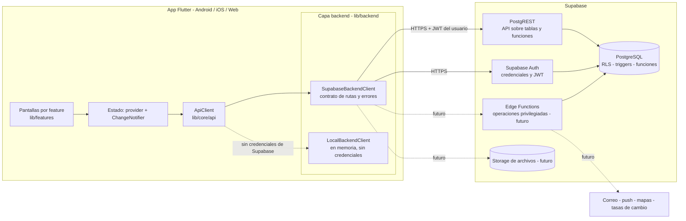
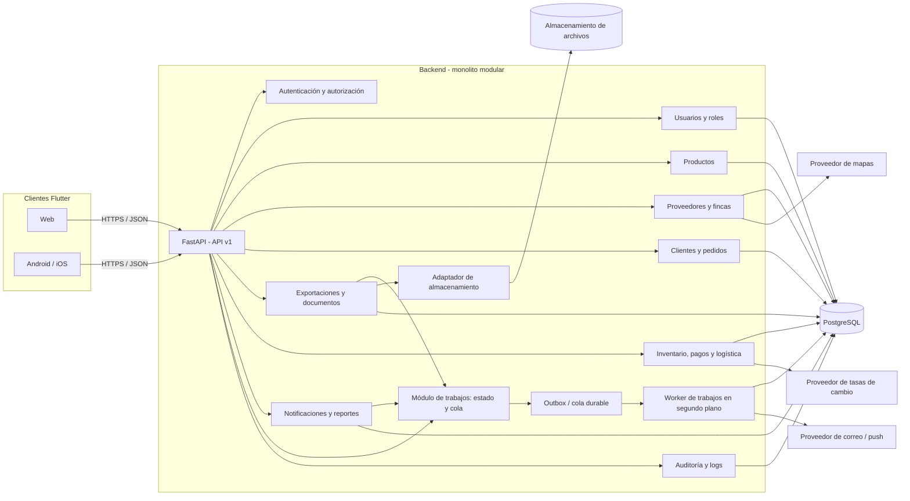

# Arquitectura de software

**Proyecto:** Plataforma de exportación de café y cacao
**Versión:** 0.2 - backend en Flutter + Supabase
**Estado:** Arquitectura vigente en las secciones 1 a 3; las secciones A1 a A7 son la propuesta v0.1 (FastAPI), reemplazada y conservada solo como referencia histórica. Pendiente de aprobación docente/cliente.
**Última actualización:** 2026-10-08. Decisiones en `decisiones-arquitectura.md` (ADR-018 a ADR-021).

## 1. Decisión arquitectónica

La plataforma es una **aplicación Flutter** (Android, iOS y Web) con una **capa de backend dentro de la propia app** (`lib/backend`) que se apoya en **Supabase** como plataforma de datos:

- **Supabase Auth:** credenciales (hash bcrypt), sesión y JWT.
- **PostgreSQL con RLS, triggers y funciones:** datos y reglas de integridad y permisos.
- **PostgREST:** la API HTTP sobre tablas y funciones, que la app consume con el JWT del usuario.

No hay servidor de aplicación propio. La app solo contiene la clave pública de Supabase; las operaciones que exigen privilegios totales (por ejemplo, cambiar el correo de otro usuario) quedan reservadas a **Edge Functions** futuras y nunca a la app (ADR-020).

## 2. Diagrama de componentes



El diagrama muestra límites lógicos. La app y Supabase son los dos únicos despliegues; no hay worker ni cola propios. Los módulos de dominio (usuarios y roles hoy; productos, pedidos, exportaciones, inventario, pagos y notificaciones después) se añaden como tablas y reglas en la base, más sus rutas en `lib/backend` y sus pantallas en `lib/features`.

## 3. Dónde vive la lógica de negocio

| Tipo de lógica | Dónde vive | Ejemplos actuales | Por qué |
|---|---|---|---|
| Integridad y permisos | **PostgreSQL** (RLS, triggers, funciones) | Quién puede leer/editar cada tabla; no desactivarse a sí mismo; siempre un administrador activo; el registro asigna siempre el rol `cliente`; el correo confirmado se copia al perfil | Se aplica aunque alguien llame a la API sin pasar por la app; el cliente no es de confianza |
| Validación de entrada y traducción de errores | **Capa `lib/backend`** | Formato de correo, nombres obligatorios, normalización del nombre de rol, mapeo de errores de la base a códigos y mensajes | Da un contrato único a las pantallas y mensajes accionables |
| Presentación y flujo de pantallas | **`lib/features`** | Formularios, navegación, qué opciones se muestran según permisos | Es solo comodidad: la seguridad real está en la base |
| Operaciones con privilegios totales | **Edge Functions (futuro)** | Cambiar el correo de otro usuario | Requieren la clave `service_role`, que no puede ir en la app |

Regla práctica: *toda regla cuyo incumplimiento sea un problema de seguridad o de integridad de datos debe estar en la base; la app solo valida para dar buena experiencia.* Ver ADR-019.

## 3.1 Estructura del cliente

```
lib/
  app/            # app, router (go_router), preferencias
  backend/        # SupabaseBackendClient, LocalBackendClient, almacén local
  core/           # ApiClient, configuración, errores
  features/       # auth, users, roles, profile (una carpeta por módulo)
supabase/
  schema.sql      # esquema, reglas, RLS y datos base, versionado con el código
```

## 3.2 Consecuencias y riesgos

- **Dependencia de Supabase:** disponibilidad, límites y costos son los del plan contratado (RNF-08, RNF-09, RNF-19).
- **Reglas en SQL:** requieren pruebas contra la base real; las reglas de `schema.sql` están aplicadas pero solo parcialmente ejercitadas.
- **Sin tareas en segundo plano:** reportes pesados, correos y notificaciones programadas necesitarán Edge Functions o tareas programadas de la base (decisión pendiente, ADR-003 en revisión).
- **Cierre del cliente:** una app descompilada expone la clave pública; por eso RLS es obligatoria en toda tabla (RNF-18).

---

# Anexo histórico: propuesta v0.1 (FastAPI) - reemplazada

> Las secciones siguientes describen la propuesta anterior (monolito FastAPI + SQLAlchemy + worker). **Ya no es la arquitectura vigente.** Se conservan como referencia de las responsabilidades por módulo, que siguen siendo útiles al diseñar las tablas y reglas de cada dominio.

## A1. Decisión arquitectónica

Se propone un **monolito modular**: una API REST en FastAPI con módulos de negocio separados dentro de un mismo despliegue. Flutter será el cliente para Android, iOS y Web. PostgreSQL será la base de datos relacional propuesta; SQLAlchemy será la capa de persistencia.

La propuesta conserva la dirección técnica observada en la versión anterior del proyecto (FastAPI, SQLAlchemy síncrono y Psycopg síncrono), sin conservar ni restaurar su código. La selección de base de datos, proveedor de archivos y plataforma de despliegue debe aprobarse antes de implementación.

## A2. Diagrama de componentes



El diagrama muestra límites lógicos, no despliegues independientes. Los módulos de dominio comparten proceso y base de datos, pero cada uno es dueño de sus reglas y operaciones. Las integraciones externas se aíslan tras adaptadores para poder sustituir proveedores sin propagar sus SDK por los módulos.

## A3. Estructura propuesta del backend

```text
backend/
  app/
    main.py                    # crea FastAPI y registra el router raíz
    api/
      router.py                # agrega todos los routers de versión
      v1/
        router.py              # agrega routers del API v1
    core/
      config.py                # configuración y variables de entorno
      security.py              # JWT, hash y dependencias de usuario/permisos
      errors.py                # errores HTTP y excepciones comunes
      logging.py               # configuración de logs
    database/
      session.py               # engine, sesiones y dependencia de DB
      base.py                  # metadata/modelos para migraciones
    modules/
      auth/
        router.py              # login y recuperación
        schemas.py
        service.py
      users/
        router.py              # usuarios y perfil
        schemas.py
        models.py
        service.py
        repository.py
      roles/                    # router, schemas, models, service, repository
      products/                 # router, schemas, models, service, repository
      suppliers/                # proveedores, fincas y geolocalización
      customers/                # clientes
      orders/                   # pedidos y estados
      exports/                  # exportaciones, HS y EUDR
      documents/                # generación y expediente documental
      inventory/                # existencias y movimientos
      payments/                 # pagos y conversión de moneda
      logistics/                # transportistas, guías y eventos
      notifications/            # centro y reglas de notificación
      reports/                  # consultas y generación de informes
      audit/                    # registro de acciones críticas
      jobs/                     # trabajos, outbox y worker
        router.py              # consulta del estado de trabajos
        schemas.py
        service.py
        models.py
        worker.py
    integrations/
      files/                    # interfaz y adaptador de almacenamiento
      email/                    # interfaz y adaptador de correo
      maps/                     # interfaz para mapas/geocodificación
      exchange_rates/           # adaptador para tasas de cambio
      push/                     # adaptador para notificaciones push
    migrations/
    tests/
```

Cada módulo expone un `router.py` que declara rutas HTTP y delega reglas al `service.py`. `schemas.py` define contratos de entrada/salida y validación; `models.py` declara entidades ORM cuando el módulo persiste datos; `repository.py` concentra consultas y escritura de persistencia. Los routers no deben contener reglas de negocio ni acceder directamente al engine.

### Agregación de routers

- `app/api/v1/router.py` incluye los routers de cada módulo bajo `/api/v1`.
- `app/api/router.py` monta la versión activa y rutas comunes de salud.
- `app/main.py` crea la aplicación, ciclo de vida y middleware, y monta `app.api.router`.
- Prefijos sugeridos: `/auth`, `/users`, `/roles`, `/products`, `/suppliers`, `/farms`, `/customers`, `/orders`, `/exports`, `/documents`, `/inventory`, `/payments`, `/shipments`, `/notifications`, `/reports` y `/jobs`.
- Las rutas protegidas declaran dependencias de autenticación y autorización por permiso. Los servicios validan reglas de dominio independientemente de la interfaz HTTP.
- La versión `/api/v1` forma parte del contrato; cambios incompatibles requieren una nueva versión.

## A4. Estructura propuesta del cliente Flutter

```text
frontend/
  android/                     # aplicación Android
  ios/                          # aplicación iOS
  web/                          # cliente Flutter Web
  pubspec.yaml
  pubspec.lock
  lib/
    main.dart
    app/
      app.dart                  # raíz de navegación y ciclo de sesión
      router/                   # definición central de rutas y deep links
      state/                    # estado global de aplicación
    core/
      api/                      # cliente HTTP, token y manejo de errores
      auth/                     # estado de sesión y permisos
      config/                   # URLs y configuración por entorno
    shared/
      widgets/                  # componentes visuales reutilizables
      models/                   # tipos compartidos pequeños y estables
    features/
      auth/
      dashboard/
      users/
      products/
      suppliers/
      customers/
      orders/
      exports/
      documents/
      inventory/
      payments/
      logistics/
      notifications/
      reports/
  test/
```

Cada feature agrupa presentación, estado y acceso a datos propios. El estado compartido usa Provider/ChangeNotifier; el estado efímero de un widget permanece local con `setState`. La interfaz aplica permisos para navegación/visibilidad, pero la autorización efectiva siempre se valida en backend.

## A5. Ejecución síncrona y asíncrona

### Decisión

Las solicitudes REST ordinarias se procesarán de forma **síncrona**: endpoints `def`, sesión SQLAlchemy síncrona y Psycopg síncrono. Esta decisión coincide con el backend anterior y cubre CRUD, autenticación, filtros, validaciones y cálculos pequeños. No se deben declarar endpoints `async def` que ejecuten directamente operaciones bloqueantes de SQLAlchemy/Psycopg o SDK síncronos.

Las tareas **asíncronas de negocio** se ejecutarán en un worker separado cuando puedan tardar más que la respuesta interactiva o dependan de un proveedor externo: generar reportes/PDF grandes, enviar correo o push, y procesos por lotes. El worker puede ser síncrono internamente; “asíncrono” describe que el cliente no espera la finalización dentro de la solicitud HTTP, no que sea obligatorio usar `asyncio`.

### Flujo de trabajo en segundo plano

1. La API valida permisos y datos, registra una solicitud de trabajo y confirma la transacción.
2. La solicitud deja una entrada durable en outbox/cola para evitar perder el trabajo si el proceso termina tras confirmar los datos.
3. Un worker toma el trabajo, ejecuta la operación y guarda estado `queued`, `running`, `succeeded` o `failed`, con referencia al resultado o error recuperable.
4. El cliente recibe `202 Accepted` y un identificador; consulta `GET /api/v1/jobs/{job_id}` hasta obtener el resultado, o recibe una notificación cuando se acuerde ese mecanismo.
5. Reintentos deben ser limitados e idempotentes; errores definitivos quedan visibles para revisión y no se reintentan indefinidamente.

Para reportes y PDFs, el backlog fija un máximo de 5 segundos bajo condiciones normales. Se intentará responder directamente dentro de ese límite; si el trabajo excede el umbral o procesa un volumen alto, se enviará al worker y el cliente consultará el estado. Las condiciones exactas de “normal” deben definirse en RNF-06 antes de aceptación.

La tecnología de cola (por ejemplo, tabla outbox con worker inicial o broker dedicado), su despliegue y concurrencia quedan pendientes. No se añade una dependencia concreta hasta conocer infraestructura, volumen y criterios de entrega.

## A6. Criterios de evolución

- Mantener el monolito modular mientras los módulos compartan despliegue y equipo; no separar microservicios sin necesidad operativa medida.
- No permitir importaciones circulares ni que un módulo escriba tablas de otro directamente; las interacciones pasan por servicios/contratos definidos.
- Mantener transacciones cortas y consistencia en operaciones que afecten pedidos, exportaciones e inventario.
- Registrar trabajos y acciones críticas sin almacenar contraseñas, tokens ni datos sensibles innecesarios en logs.
- Acordar base de datos, cola durable, proveedores externos, estados de procesos y política de retención antes de implementar integraciones.

## A7. Decisiones pendientes

1. Aprobar PostgreSQL y confirmar proveedor/entorno de despliegue.
2. Definir proveedor de cola/outbox y estrategia de worker, reintentos e idempotencia.
3. Definir endpoints y contrato de consulta de trabajos, retención de resultados y notificación de finalización.
4. Confirmar módulos y permisos según la matriz de roles aprobada.
5. Seleccionar proveedores de mapas, tasas de cambio, correo, push y almacenamiento.
6. Acordar tamaño/volumen a partir del cual reportes y PDFs pasan a ejecución en segundo plano.
