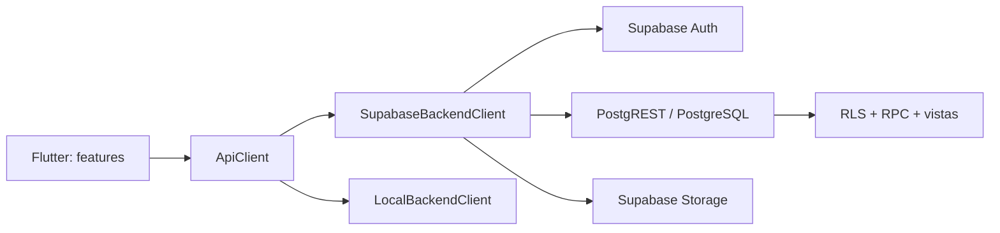

# Arquitectura de RiExport

## Estado y límites

RiExport es un cliente Flutter para Android, iOS y web. `lib/app/router/app_router.dart` contiene la navegación; `lib/features/` agrupa las pantallas por dominio; `lib/core/api/` contiene el cliente HTTP; `lib/backend/` implementa los contratos para Supabase y para el modo local en memoria.

En producción la app usa Supabase Auth, PostgREST, PostgreSQL y Storage. La clave pública se configura con `SUPABASE_URL` y `SUPABASE_ANON_KEY`; las decisiones de acceso se aplican en RLS y funciones PostgreSQL. El modo local sirve para desarrollo y pruebas, no persiste datos al cerrar la app.

## Módulos implementados

- Identidad: registro, autenticación, recuperación, perfil, usuarios, roles y permisos.
- Catálogos: productos, proveedores, fincas y lotes.
- Comercial: clientes, cuentas vinculadas, pedidos, transiciones de pedido e inventario por lote.
- Origen: selector de coordenadas y mapas de fincas/lotes.
- Exportaciones: registro desde pedidos, historial, declaración EUDR y generación de PDF (Edge Function `generate-document`, sin ejecutar en este entorno). Envíos: lista y mapa de trazabilidad; la actualización de estado logístico (EP-10) y la carga de documentos (EP-7) quedan fuera de esta etapa.

## Fuentes de verdad

Las migraciones ordenadas en `database/migrations/` son la fuente del esquema. No hay un `schema.sql` consolidado: el esquema es la suma ordenada de las migraciones. `LocalBackendClient` debe mantener el contrato de rutas y permisos de Supabase cuando el flujo se use en modo local.

Los requisitos de cliente y cualquier decisión comercial no confirmada se marcan como propuesta; este documento no representa una aprobación del cliente.
