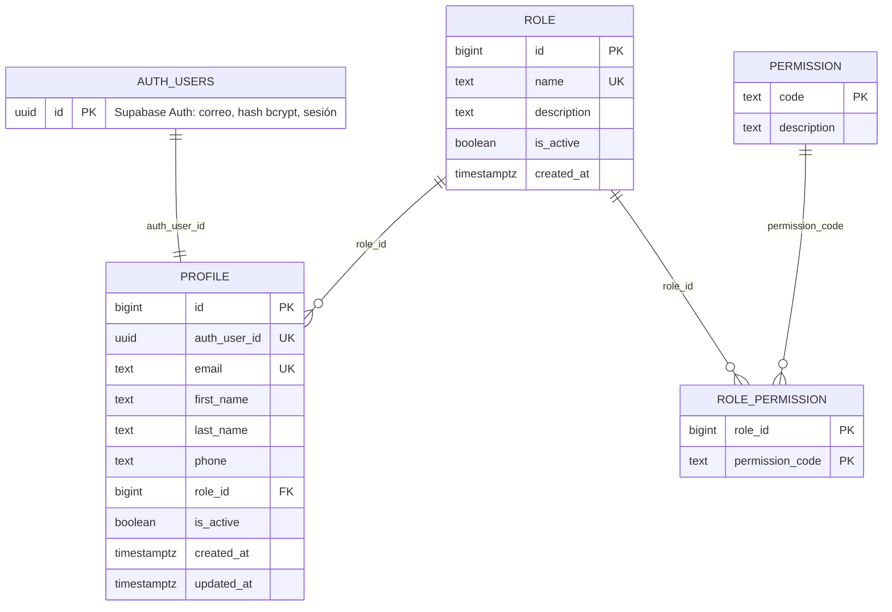
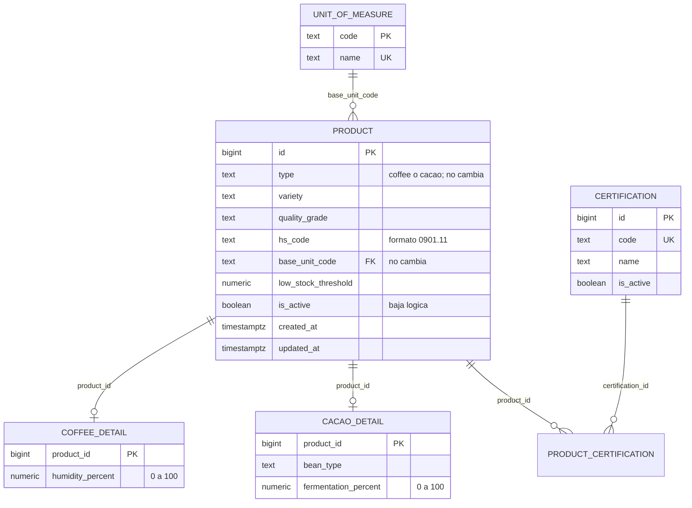

# Modelo de datos inicial

**Proyecto:** Plataforma de exportación de café y cacao  
**Versión:** 0.2 - modelo lógico normalizado; área Acceso implementada en Supabase  
**Estado:** Propuesta revisada; el área Acceso está aplicada en Supabase (2026-10-08), el resto sigue sin DDL  
**Motor:** PostgreSQL gestionado por Supabase (ADR-018)

## 1. Criterios del modelo

- Claves internas `BIGINT` generadas por la base de datos; horas con zona almacenadas como `TIMESTAMPTZ` en UTC.
- Códigos de país, moneda y unidad se normalizan en catálogos. Cantidades, precios y tasas usan `NUMERIC`, nunca `FLOAT`.
- Los tipos específicos de café y cacao se guardan en tablas de detalle 1:1 con producto.
- Los pedidos y exportaciones usan tablas de líneas para soportar varios productos; esta cardinalidad se propone y debe confirmarse.
- El inventario se calcula desde movimientos por lote. No existe un saldo editable duplicado.
- Los datos necesarios para reproducir una exportación se conservan en sus líneas, incluido el HS aplicado al momento de la operación.
- Los archivos binarios viven en almacenamiento de archivos/objetos. La base guarda metadatos, hash y clave de almacenamiento.

## 2. Entidades y relaciones

| Área | Entidades | Relaciones principales |
|---|---|---|
| Acceso | `auth.users` (Supabase Auth), `profile`, `role`, `permission`, `role_permission` | Una cuenta de Auth tiene un perfil; un rol tiene muchos perfiles; roles y permisos son N:M. `password_reset_token` ya no existe: la recuperación la gestiona Supabase Auth. **Implementado.** |
| Catálogo | `product`, `coffee_detail`, `cacao_detail`, `certification`, `product_certification`, `unit_of_measure` | Producto tiene un detalle café o cacao; productos y certificaciones son N:M; cada producto define una unidad base. |
| Origen | `supplier`, `farm`, `product_lot`, `country` | Un proveedor tiene muchas fincas; una finca contiene muchos lotes; cada lote corresponde a un producto y finca. |
| Comercial | `customer`, `customer_order`, `order_line`, `currency` | Un cliente tiene muchos pedidos; un pedido tiene una o más líneas; cada línea identifica un producto. |
| Exportación | `export`, `export_line`, `incoterm` | Un pedido puede originar varias exportaciones; cada exportación tiene líneas vinculadas a líneas del pedido y a lotes de origen. |
| Inventario | `inventory_movement` | Un lote tiene muchos movimientos; una operación de pedido/exportación puede originar movimientos trazables. |
| Pagos | `payment_obligation`, `payment_transaction`, `exchange_rate` | Un pedido tiene obligaciones; una obligación puede recibir varios abonos; cada conversión usa una tasa identificable. |
| Logística | `shipment`, `shipment_event` | Una exportación puede tener varios envíos; cada envío mantiene eventos ordenados cronológicamente. |
| Documentos | `stored_file`, `export_document` | Un archivo puede ser foto de perfil o adjunto de un documento; cada documento pertenece a una exportación. |
| Transversal | `notification`, `audit_log`, `background_job`, `outbox_message` | Notificaciones tienen destinatario; auditoría registra actor/objeto; una solicitud de trabajo produce mensaje outbox durable. |

## 2.1 Modelo implementado en Supabase (área Acceso)

Aplicado en la base el 2026-10-08 (`database/migrations/`). Las demás áreas siguen como propuesta lógica y **no están creadas**.

**Cambios respecto del modelo lógico v0.1:**

- `app_user` pasa a `profile`: el correo, la contraseña y la sesión viven en `auth.users` (Supabase Auth); `profile` conserva los datos de negocio y el rol, enlazados por `auth_user_id`. Se elimina `password_hash`.
- `password_reset_token` desaparece: la recuperación de acceso la gestiona Supabase Auth.
- `profile.photo_file_id` se pospone hasta crear `stored_file` (Supabase Storage).
- `role_permission` no tiene `created_at` por ahora.
- Integridad: `role.name` con formato `^[a-z][a-z0-9_]{1,59}$`; longitudes acotadas en nombres, teléfono y descripción; `profile.role_id` sin borrado en cascada.
- Reglas en triggers y políticas RLS: ver `modelo-autorizacion-rls.md`.
- `audit_log` está **implementada** (migración `20261008000600`): `TEXT` con `CHECK` de longitud en `action` y `entity_type`, `request_id` como `TEXT`, FK del actor con `ON DELETE SET NULL`, append-only (triggers que impiden `UPDATE`, `DELETE` y `TRUNCATE`, salvo el `SET NULL` del actor) y solo `SELECT` para usuarios con `audit.read`. Hoy registra los cambios de rol (`user.role_changed`; metadatos: ids y nombres de rol de origen y destino).
- Las tablas `background_job` y `outbox_message` quedan **en revisión** (ADR-018, ADR-010): ya no hay worker propio.

## 2.2 Verificación de consistencia (2026-10-08)

Comprobación automática del documento: las **33 entidades** de la sección 2 coinciden exactamente con las del diagrama ER (sección 3, 52 relaciones) y con las tablas del diccionario (sección 4); el diccionario declara 52 claves foráneas y todas apuntan a tablas definidas; cada tabla declara su clave primaria. Si se añade o renombra una entidad, deben actualizarse las tres secciones.

Estado de implementación: el área **Acceso** (sección 2.1), la tabla `audit_log` los **productos** (sección 2.3) y sus catálogos también; las otras 22 entidades están como propuesta lógica.

## 2.3 Productos implementados en Supabase (EP-2)

Aplicado el 2026-10-08 (migración `20261008000700`).

**Diferencias respecto del diccionario v0.1:**

- Se usa `TEXT` con `CHECK` de longitud en lugar de `VARCHAR(n)`; `product` gana `created_at` y `updated_at`.
- **Índice único** `(type, lower(variety), lower(quality_grade))`: evita duplicados (supuesto a confirmar con el cliente).
- `hs_code` tiene `CHECK` de formato (`^[0-9]{4}(\.[0-9]{2}){0,3}$`); la fuente y la versión del arancel siguen pendientes.
- El tipo y la unidad base no se pueden cambiar; los productos **no se borran** (triggers, también para el propietario). Las claves foráneas de los detalles no tienen borrado en cascada.
- Semilla: `unit_of_measure` (`kg`, `t`) y `certification` (`ORGANIC`, `FAIR_TRADE`, `RAINFOREST_ALLIANCE`).
- La vista `product_catalog` (`security_invoker`) une producto, detalle, unidad y certificaciones (como lista y como arreglo de ids para filtrar) y alimenta el catálogo de la app.

## 3. Diagrama entidad-relación

El diagrama muestra las entidades de negocio; la relación de `profile` con `auth.users` (Supabase Auth) está en la sección 2.1.

```mermaid
erDiagram
    COUNTRY ||--o{ CUSTOMER : domicilia
    COUNTRY ||--o{ SUPPLIER : domicilia
    COUNTRY ||--o{ FARM : ubica
    COUNTRY ||--o{ EXPORT : destino
    CURRENCY ||--o{ CUSTOMER : preferida
    CURRENCY ||--o{ CUSTOMER_ORDER : denomina
    CURRENCY ||--o{ PAYMENT_OBLIGATION : denomina
    CURRENCY ||--o{ PAYMENT_TRANSACTION : denomina
    CURRENCY ||--o{ EXCHANGE_RATE : moneda_origen
    CURRENCY ||--o{ EXCHANGE_RATE : moneda_destino
    UNIT_OF_MEASURE ||--o{ PRODUCT : unidad_base
    ROLE ||--o{ PROFILE : asignado
    ROLE ||--o{ ROLE_PERMISSION : contiene
    PERMISSION ||--o{ ROLE_PERMISSION : asignado
    PROFILE o|--o| STORED_FILE : foto_perfil
    PROFILE ||--o{ STORED_FILE : carga
    PROFILE ||--o{ CUSTOMER_ORDER : crea
    PROFILE ||--o{ INVENTORY_MOVEMENT : registra
    PROFILE ||--o{ PAYMENT_TRANSACTION : registra
    PROFILE ||--o{ SHIPMENT_EVENT : registra
    PROFILE ||--o{ NOTIFICATION : recibe
    PROFILE o|--o{ AUDIT_LOG : actor
    PRODUCT ||--o| COFFEE_DETAIL : tiene
    PRODUCT ||--o| CACAO_DETAIL : tiene
    PRODUCT ||--o{ PRODUCT_CERTIFICATION : obtiene
    CERTIFICATION ||--o{ PRODUCT_CERTIFICATION : asignada
    PRODUCT ||--o{ PRODUCT_LOT : produce
    SUPPLIER ||--o{ FARM : administra
    FARM ||--o{ PRODUCT_LOT : origina
    CUSTOMER ||--o{ CUSTOMER_ORDER : realiza
    CUSTOMER_ORDER ||--|{ ORDER_LINE : contiene
    PRODUCT ||--o{ ORDER_LINE : solicitado
    CUSTOMER_ORDER ||--o{ EXPORT : formaliza
    INCOTERM ||--o{ EXPORT : pacta
    EXPORT ||--|{ EXPORT_LINE : contiene
    ORDER_LINE ||--o{ EXPORT_LINE : satisface
    PRODUCT_LOT ||--o{ EXPORT_LINE : trazado
    PRODUCT_LOT ||--o{ INVENTORY_MOVEMENT : afecta
    ORDER_LINE o|--o{ INVENTORY_MOVEMENT : reserva_o_resta
    EXPORT_LINE o|--o{ INVENTORY_MOVEMENT : despacha
    CUSTOMER_ORDER ||--o{ PAYMENT_OBLIGATION : genera
    PAYMENT_OBLIGATION ||--o{ PAYMENT_TRANSACTION : recibe
    EXCHANGE_RATE o|--o{ PAYMENT_TRANSACTION : convierte
    EXPORT ||--o{ SHIPMENT : despacha
    SHIPMENT ||--|{ SHIPMENT_EVENT : registra
    EXPORT ||--o{ EXPORT_DOCUMENT : archiva
    STORED_FILE ||--o{ EXPORT_DOCUMENT : contiene
    PRODUCT_LOT o|--o{ NOTIFICATION : stock_bajo
    PAYMENT_OBLIGATION o|--o{ NOTIFICATION : vencimiento
    PROFILE ||--o{ BACKGROUND_JOB : solicita
    STORED_FILE o|--o| BACKGROUND_JOB : resultado
    BACKGROUND_JOB ||--o| OUTBOX_MESSAGE : publica
```

La notación `o|` expresa una relación opcional. Para `notification`, exactamente uno de `product_lot_id` o `payment_obligation_id` debe tener valor según el tipo de alerta. `audit_log.entity_type/entity_id` es una referencia polimórfica intencional, no una FK relacional; se valida y protege desde el servicio de auditoría.

## 4. Diccionario de datos

Los campos `id` en tablas principales son `BIGINT GENERATED BY DEFAULT AS IDENTITY PRIMARY KEY`, salvo que se indique otra clave. Las entidades mutables (`role`, `profile`, `product`, `certification`, `supplier`, `farm`, `customer`, `customer_order`, `export`) incluyen `created_at` y `updated_at` como `TIMESTAMPTZ NOT NULL` UTC, aunque no se repitan en cada fila. Tablas de asociación, movimientos, eventos, archivos y registros técnicos usan solo las fechas de creación/ocurrencia indicadas. `is_active` representa baja lógica donde aplica. Los rangos de precisión son propuestas iniciales y deben ajustarse al volumen comercial esperado.

### Catálogos y acceso

| Tabla | Campo | Tipo / clave | Regla y significado |
|---|---|---|---|
| `country` | `code` | `CHAR(2) PK` | Código ISO 3166-1 alpha-2; catálogo controlado. |
|  | `name` | `VARCHAR(100) UNIQUE NOT NULL` | Nombre visible del país. |
| `currency` | `code` | `CHAR(3) PK` | Código ISO 4217. |
|  | `name` | `VARCHAR(80) NOT NULL` | Nombre de moneda. |
|  | `minor_units` | `SMALLINT NOT NULL` | Decimales menores permitidos; validar contra catálogo vigente. |
| `unit_of_measure` | `code` | `VARCHAR(12) PK` | Código estable, p. ej. `kg`, `t`. |
|  | `name` | `VARCHAR(60) NOT NULL` | Nombre de unidad. No se realizan conversiones implícitas entre unidades. |
| `role` | `id` | `BIGINT PK` | Identificador. |
|  | `name` | `VARCHAR(60) UNIQUE NOT NULL` | Nombre del rol. *Implementado como `TEXT` con `CHECK` de formato `^[a-z][a-z0-9_]{1,59}$`.* |
|  | `description` | `VARCHAR(250) NULL` | Descripción. |
|  | `is_active` | `BOOLEAN NOT NULL DEFAULT TRUE` | No asignable si está inactivo. |
|  | `created_at` | `TIMESTAMPTZ NOT NULL DEFAULT now()` | *Añadido en la implementación (no estaba en el modelo v0.1).* |
| `permission` | `code` | `VARCHAR(100) PK` *(implementado como `TEXT`)* | Código `modulo.accion`, p. ej. `orders.read`. |
|  | `description` | `VARCHAR(250) NOT NULL` | Acción protegida que representa. |
| `role_permission` | `role_id` | `BIGINT PK, FK -> role.id` | Rol asociado. |
|  | `permission_code` | `VARCHAR(100) PK, FK -> permission.code` | Permiso asociado; PK compuesta evita duplicados. |
|  | `created_at` | `TIMESTAMPTZ NOT NULL` | Momento en que se asignó. *No implementado todavía; añadir si se necesita auditar asignaciones.* |
| `profile` | `id` | `BIGINT PK (identidad)` | Identificador de cuenta usado por la app y por las demás tablas. |
|  | `auth_user_id` | `UUID UNIQUE NOT NULL FK -> auth.users.id ON DELETE CASCADE` | Enlace con Supabase Auth, que guarda correo, contraseña (bcrypt) y sesión. |
|  | `email` | `TEXT UNIQUE NOT NULL` | Copia en minúsculas del correo de Auth; se actualiza por trigger al confirmar un cambio. |
|  | `first_name`, `last_name` | `TEXT NOT NULL CHECK (1..100)` | Nombre del usuario. |
|  | `phone` | `TEXT NULL CHECK (<= 32)` | Teléfono de contacto. |
|  | `role_id` | `BIGINT FK -> role.id NOT NULL` | Un rol por usuario; toda cuenta nueva recibe `cliente`. |
|  | `is_active` | `BOOLEAN NOT NULL DEFAULT TRUE` | Baja lógica; bloquea inicio de sesión. |
|  | `created_at`, `updated_at` | `TIMESTAMPTZ NOT NULL DEFAULT now()` | Alta y última modificación (la actualiza un trigger). |
|  | *(pendiente)* `photo_file_id` | `BIGINT FK -> stored_file.id NULL UNIQUE` | Foto opcional; se añadirá al crear `stored_file`. |

### Productos y origen

| Tabla | Campo | Tipo / clave | Regla y significado |
|---|---|---|---|
| `product` | `id` | `BIGINT PK` | Identificador. |
|  | `type` | `VARCHAR(10) NOT NULL` | `coffee` o `cacao`; `CHECK` de valores. |
|  | `variety` | `VARCHAR(120) NOT NULL` | Variedad del producto. |
|  | `quality_grade` | `VARCHAR(80) NOT NULL` | Grado/calidad comercial. Catálogo por definir. |
|  | `hs_code` | `VARCHAR(20) NULL` | Clasificación vigente propuesta para el producto; fuente/versión pendientes. |
|  | `base_unit_code` | `VARCHAR(12) FK -> unit_of_measure.code NOT NULL` | Unidad para cantidades del producto. |
|  | `low_stock_threshold` | `NUMERIC(18,3) NULL` | Umbral de alerta en unidad base; debe ser no negativo. |
|  | `is_active` | `BOOLEAN NOT NULL DEFAULT TRUE` | Inactivación sin perder referencias históricas. |
| `coffee_detail` | `product_id` | `BIGINT PK, FK -> product.id` | Un detalle de café por producto tipo `coffee`. |
|  | `humidity_percent` | `NUMERIC(5,2) NOT NULL` | Humedad de 0 a 100; `CHECK`. |
| `cacao_detail` | `product_id` | `BIGINT PK, FK -> product.id` | Un detalle de cacao por producto tipo `cacao`. |
|  | `bean_type` | `VARCHAR(100) NOT NULL` | Tipo de grano. |
|  | `fermentation_percent` | `NUMERIC(5,2) NOT NULL` | Porcentaje de fermentación 0 a 100; `CHECK`. |
| `certification` | `id` | `BIGINT PK` | Identificador. |
|  | `code` | `VARCHAR(50) UNIQUE NOT NULL` | Código estable de certificación. |
|  | `name` | `VARCHAR(120) NOT NULL` | Nombre visible. |
|  | `is_active` | `BOOLEAN NOT NULL DEFAULT TRUE` | Evita nuevas asignaciones sin borrar historial. |
| `product_certification` | `product_id` | `BIGINT PK, FK -> product.id` | Producto. |
|  | `certification_id` | `BIGINT PK, FK -> certification.id` | Certificación; PK compuesta. |
| `supplier` | `id` | `BIGINT PK` | Identificador. |
|  | `business_name` | `VARCHAR(180) NOT NULL` | Nombre o razón social. |
|  | `contact_name` | `VARCHAR(160) NULL` | Contacto. |
|  | `email` | `VARCHAR(254) NULL` | Correo. |
|  | `phone` | `VARCHAR(32) NULL` | Teléfono. |
|  | `country_code` | `CHAR(2) FK -> country.code NOT NULL` | País del proveedor. |
|  | `address` | `VARCHAR(300) NULL` | Dirección textual. |
|  | `is_active` | `BOOLEAN NOT NULL DEFAULT TRUE` | Baja lógica. |
| `farm` | `id` | `BIGINT PK` | Identificador de finca. |
|  | `supplier_id` | `BIGINT FK -> supplier.id NOT NULL` | Proveedor responsable. |
|  | `country_code` | `CHAR(2) FK -> country.code NOT NULL` | País de ubicación. |
|  | `name` | `VARCHAR(160) NOT NULL` | Nombre de finca. |
|  | `address` | `VARCHAR(300) NULL` | Ubicación legible. |
|  | `latitude`, `longitude` | `NUMERIC(9,6)`, `NUMERIC(9,6)` | Coordenadas; rangos -90..90 y -180..180. Polígonos EUDR no incluidos todavía. |
|  | `is_active` | `BOOLEAN NOT NULL DEFAULT TRUE` | Baja lógica. |
| `product_lot` | `id` | `BIGINT PK` | Identificador de lote. |
|  | `product_id` | `BIGINT FK -> product.id NOT NULL` | Producto del lote. |
|  | `farm_id` | `BIGINT FK -> farm.id NOT NULL` | Origen productivo. |
|  | `lot_code` | `VARCHAR(80) NOT NULL` | Código local; `UNIQUE(farm_id, lot_code)`. |
|  | `created_at` | `TIMESTAMPTZ NOT NULL` | Fecha de registro; cosecha/producción no está especificada en el backlog. |

### Clientes y operación comercial

| Tabla | Campo | Tipo / clave | Regla y significado |
|---|---|---|---|
| `customer` | `id` | `BIGINT PK` | Identificador. |
|  | `name` | `VARCHAR(180) NOT NULL` | Nombre/razón social. |
|  | `contact_name` | `VARCHAR(160) NULL` | Contacto comercial. |
|  | `email` | `VARCHAR(254) NULL` | Correo de contacto. |
|  | `country_code` | `CHAR(2) FK -> country.code NOT NULL` | País para búsqueda y reglas EORI. |
|  | `eori_number` | `VARCHAR(35) UNIQUE NULL` | Identificador EORI cuando aplique; formato y obligatoriedad se validan por país. |
|  | `preferred_currency_code` | `CHAR(3) FK -> currency.code NOT NULL` | Moneda preferida. |
|  | `is_active` | `BOOLEAN NOT NULL DEFAULT TRUE` | Inactivación conservando historial. |
| `customer_order` | `id` | `BIGINT PK` | Identificador. |
|  | `order_number` | `VARCHAR(40) UNIQUE NOT NULL` | Número legible generado por sistema. |
|  | `customer_id` | `BIGINT FK -> customer.id NOT NULL` | Cliente. |
|  | `created_by_id` | `BIGINT FK -> profile.id NOT NULL` | Usuario que registró el pedido. |
|  | `status` | `VARCHAR(20) NOT NULL` | `pending`, `confirmed`, `in_process`, `exported`; transiciones validadas en servicio. |
|  | `currency_code` | `CHAR(3) FK -> currency.code NOT NULL` | Moneda común de las líneas. |
|  | `created_at`, `updated_at` | `TIMESTAMPTZ NOT NULL` | Fechas de alta y última actualización. |
| `order_line` | `id` | `BIGINT PK` | Identificador de línea. |
|  | `order_id` | `BIGINT FK -> customer_order.id NOT NULL` | Pedido. |
|  | `product_id` | `BIGINT FK -> product.id NOT NULL` | Producto. |
|  | `quantity` | `NUMERIC(18,3) NOT NULL CHECK (quantity > 0)` | Cantidad expresada en unidad base del producto. |
|  | `unit_price` | `NUMERIC(18,4) NOT NULL CHECK (unit_price >= 0)` | Precio en moneda del pedido. |
| `incoterm` | `code`, `edition_year` | `VARCHAR(8) PK compuesta, SMALLINT PK compuesta` | Código/edición para conservar definición aplicable. Catálogo habilitado por el negocio. |
|  | `name` | `VARCHAR(100) NOT NULL` | Nombre/descripción del término. |
| `export` | `id` | `BIGINT PK` | Identificador. |
|  | `order_id` | `BIGINT FK -> customer_order.id NOT NULL` | Pedido formalizado. |
|  | `destination_country_code` | `CHAR(2) FK -> country.code NOT NULL` | Destino. |
|  | `incoterm_code`, `incoterm_year` | `FK compuesta -> incoterm` | Incoterm/edición acordados. |
|  | `export_date` | `DATE NOT NULL` | Fecha de exportación declarada. |
|  | `status` | `VARCHAR(20) NOT NULL` | Estado de exportación; conjunto/transiciones pendientes de aprobación. |
|  | `created_by_id` | `BIGINT FK -> profile.id NOT NULL` | Usuario que registra. |
| `export_line` | `id` | `BIGINT PK` | Identificador de línea. |
|  | `export_id` | `BIGINT FK -> export.id NOT NULL` | Exportación. |
|  | `order_line_id` | `BIGINT FK -> order_line.id NOT NULL` | Línea que satisface; verificar que pertenezca al pedido asociado. |
|  | `product_lot_id` | `BIGINT FK -> product_lot.id NOT NULL` | Lote de origen para trazabilidad. |
|  | `quantity` | `NUMERIC(18,3) NOT NULL CHECK (quantity > 0)` | Cantidad exportada en unidad base del producto. |
|  | `hs_code_snapshot` | `VARCHAR(20) NOT NULL` | Código aplicado al emitir la exportación; instantánea histórica. |

### Inventario, pagos y logística

| Tabla | Campo | Tipo / clave | Regla y significado |
|---|---|---|---|
| `inventory_movement` | `id` | `BIGINT PK` | Identificador inmutable del movimiento. |
|  | `product_lot_id` | `BIGINT FK -> product_lot.id NOT NULL` | Lote afectado. |
|  | `quantity_delta` | `NUMERIC(18,3) NOT NULL CHECK (quantity_delta <> 0)` | Positivo entrada, negativo salida, en unidad base. |
|  | `reason` | `VARCHAR(30) NOT NULL` | `order_confirmed`, `export_confirmed`, `adjustment`, `reversal`; valores iniciales propuestos. |
|  | `order_line_id` | `BIGINT FK -> order_line.id NULL` | Origen por confirmación de pedido, si aplica. |
|  | `export_line_id` | `BIGINT FK -> export_line.id NULL` | Origen por exportación, si aplica. |
|  | `performed_by_id` | `BIGINT FK -> profile.id NOT NULL` | Actor o usuario de sistema identificado. |
|  | `occurred_at` | `TIMESTAMPTZ NOT NULL` | Momento efectivo; se conserva también creación técnica. |
|  | `note` | `VARCHAR(300) NULL` | Motivo de ajuste/reverso. Ajuste exige motivo. |
| `payment_obligation` | `id` | `BIGINT PK` | Obligación/cuota de cobro del pedido. |
|  | `order_id` | `BIGINT FK -> customer_order.id NOT NULL` | Pedido. |
|  | `amount_due` | `NUMERIC(20,6) NOT NULL CHECK (amount_due > 0)` | Importe previsto; aceptar solo precisión permitida por la moneda. |
|  | `currency_code` | `CHAR(3) FK -> currency.code NOT NULL` | Moneda de la obligación. |
|  | `due_date` | `DATE NOT NULL` | Fecha de vencimiento necesaria para detectar morosidad. |
| `payment_transaction` | `id` | `BIGINT PK` | Abono recibido. |
|  | `obligation_id` | `BIGINT FK -> payment_obligation.id NOT NULL` | Obligación abonada. |
|  | `amount` | `NUMERIC(20,6) NOT NULL CHECK (amount > 0)` | Abono en moneda de la obligación para MVP; validar código igual al de la obligación. |
|  | `paid_at` | `TIMESTAMPTZ NOT NULL` | Fecha/hora del pago recibido. |
|  | `exchange_rate_id` | `BIGINT FK -> exchange_rate.id NULL` | Tasa usada al convertir a moneda base. |
|  | `recorded_by_id` | `BIGINT FK -> profile.id NOT NULL` | Usuario que registra el abono. |
| `exchange_rate` | `id` | `BIGINT PK` | Identificador de observación de tasa. |
|  | `from_currency_code`, `to_currency_code` | `CHAR(3) FK -> currency.code` | Par de monedas de origen/destino. |
|  | `rate` | `NUMERIC(20,10) NOT NULL CHECK (rate > 0)` | Unidades destino por una unidad origen. |
|  | `provider` | `VARCHAR(100) NOT NULL` | Fuente del dato. |
|  | `observed_at` | `TIMESTAMPTZ NOT NULL` | Instante de vigencia reportado. |
|  | `fetched_at` | `TIMESTAMPTZ NOT NULL` | Instante de consulta. Clave única candidata: par + proveedor + `observed_at`. |
| `shipment` | `id` | `BIGINT PK` | Identificador de envío. |
|  | `export_id` | `BIGINT FK -> export.id NOT NULL` | Exportación. |
|  | `carrier` | `VARCHAR(160) NOT NULL` | Transportista. |
|  | `tracking_number` | `VARCHAR(100) NULL` | Guía o número BL; unicidad global depende de proveedor. |
|  | `created_at` | `TIMESTAMPTZ NOT NULL` | Alta del envío. El estado actual se deriva del último evento. |
| `shipment_event` | `id` | `BIGINT PK` | Identificador de evento. |
|  | `shipment_id` | `BIGINT FK -> shipment.id NOT NULL` | Envío. |
|  | `status` | `VARCHAR(20) NOT NULL` | `preparation`, `in_transit`, `customs`, `delivered`. |
|  | `occurred_at` | `TIMESTAMPTZ NOT NULL` | Fecha/hora del estado. |
|  | `description` | `VARCHAR(300) NULL` | Detalle visible en timeline. |
|  | `recorded_by_id` | `BIGINT FK -> profile.id NOT NULL` | Autor del evento. |

### Archivos, notificaciones y soporte

| Tabla | Campo | Tipo / clave | Regla y significado |
|---|---|---|---|
| `stored_file` | `id` | `BIGINT PK` | Identificador de metadatos. |
|  | `storage_key` | `VARCHAR(500) UNIQUE NOT NULL` | Clave opaca del objeto; nunca una ruta local confiada del cliente. |
|  | `original_filename` | `VARCHAR(255) NOT NULL` | Nombre saneado mostrado al usuario. |
|  | `media_type` | `VARCHAR(120) NOT NULL` | MIME validado por servidor. |
|  | `size_bytes` | `BIGINT NOT NULL CHECK (size_bytes >= 0)` | Tamaño del objeto. |
|  | `sha256` | `CHAR(64) NOT NULL` | Integridad del contenido. |
|  | `uploaded_by_id` | `BIGINT FK -> profile.id NOT NULL` | Autor de la carga. |
|  | `created_at` | `TIMESTAMPTZ NOT NULL` | Fecha de carga. |
| `export_document` | `id` | `BIGINT PK` | Identificador. |
|  | `export_id` | `BIGINT FK -> export.id NOT NULL` | Expediente al que pertenece. |
|  | `file_id` | `BIGINT FK -> stored_file.id NOT NULL` | Archivo asociado. |
|  | `type` | `VARCHAR(40) NOT NULL` | Factura, packing list, EUR.1, EUDR, fitosanitario u otro permitido. |
|  | `origin` | `VARCHAR(20) NOT NULL` | `generated` o `uploaded`. |
|  | `created_by_id` | `BIGINT FK -> profile.id NOT NULL` | Autor o solicitante. |
|  | `created_at` | `TIMESTAMPTZ NOT NULL` | Alta del documento. Hash/tipo no se sobrescriben; nueva versión crea otro registro. |
| `notification` | `id` | `BIGINT PK` | Identificador. |
|  | `recipient_user_id` | `BIGINT FK -> profile.id NOT NULL` | Destinatario. |
|  | `type` | `VARCHAR(30) NOT NULL` | `low_stock` o `payment_due` para alcance inicial. |
|  | `product_lot_id` | `BIGINT FK -> product_lot.id NULL` | Se usa para alerta de inventario. |
|  | `payment_obligation_id` | `BIGINT FK -> payment_obligation.id NULL` | Se usa para alerta de pago. |
|  | `title`, `body` | `VARCHAR(160)`, `VARCHAR(500)` | Texto capturado para consulta posterior. |
|  | `dedupe_key` | `VARCHAR(180) UNIQUE NULL` | Evita alertas duplicadas en la ventana definida. |
|  | `created_at`, `read_at` | `TIMESTAMPTZ NOT NULL`, `TIMESTAMPTZ NULL` | `read_at IS NULL` significa no leída. |
| `audit_log` | `id` | `BIGINT PK` | Identificador append-only. |
|  | `actor_user_id` | `BIGINT FK -> profile.id NULL` | Nulo para evento de sistema o cuenta eliminada. |
|  | `action` | `VARCHAR(100) NOT NULL` | Código de evento sensible. |
|  | `entity_type` | `VARCHAR(60) NOT NULL` | Tipo lógico de objeto auditado. |
|  | `entity_id` | `BIGINT NOT NULL` | ID del objeto; referencia polimórfica sin FK. |
|  | `request_id` | `VARCHAR(100) NULL` | Correlación con API/trabajo. |
|  | `metadata` | `JSONB NOT NULL DEFAULT '{}'` | Contexto mínimo, sin secretos ni copias innecesarias de datos personales. |
|  | `created_at` | `TIMESTAMPTZ NOT NULL` | Instante UTC; registro no editable desde API. |
| `background_job` *(en revisión: ADR-010)* | `id` | `BIGINT PK` | Identificador consultable por API. |
|  | `type` | `VARCHAR(60) NOT NULL` | Tipo permitido de trabajo. |
|  | `status` | `VARCHAR(20) NOT NULL` | `queued`, `running`, `succeeded`, `failed`. |
|  | `requested_by_id` | `BIGINT FK -> profile.id NOT NULL` | Propietario; define visibilidad. |
|  | `payload` | `JSONB NOT NULL` | Parámetros validados; sin credenciales. |
|  | `result_file_id` | `BIGINT FK -> stored_file.id NULL UNIQUE` | Resultado descargable; un archivo de resultado pertenece a un solo trabajo. |
|  | `error_code` | `VARCHAR(80) NULL` | Código seguro, sin stack trace expuesto. |
|  | `progress_percent` | `SMALLINT NULL CHECK (progress_percent BETWEEN 0 AND 100)` | Progreso opcional para trabajos que pueden informar avance. |
|  | `attempts`, `created_at`, `started_at`, `completed_at` | `INTEGER`, `TIMESTAMPTZ`, `TIMESTAMPTZ NULL`, `TIMESTAMPTZ NULL` | Reintentos y ciclo de vida. |
| `outbox_message` | `id` | `BIGINT PK` | Identificador del mensaje durable. |
|  | `job_id` | `BIGINT FK -> background_job.id UNIQUE NOT NULL` | Un mensaje inicial por trabajo. |
|  | `payload` | `JSONB NOT NULL` | Tipo y referencia del trabajo, no datos secretos. |
|  | `created_at`, `published_at` | `TIMESTAMPTZ NOT NULL`, `TIMESTAMPTZ NULL` | Publicación/reclamo durable. |
|  | `attempts` | `INTEGER NOT NULL DEFAULT 0` | Número de intentos, acotado por política. |

## 5. Reglas de integridad e índices

- `product.type` restringido a `coffee|cacao`; debe existir exactamente un detalle compatible (`coffee_detail` XOR `cacao_detail`). Una FK no expresa por sí sola la regla entre tablas: validarla transaccionalmente o con trigger.
- `quantity > 0` para líneas; `quantity_delta <> 0` para movimientos; porcentajes dentro de `0..100`; tasas positivas; moneda y país deben existir en catálogos.
- Índices en todas las FK consultadas y en `customer_order(customer_id,status)`, `order_line(product_id)`, `export(order_id,export_date)`, `product_lot(farm_id,product_id)`, `inventory_movement(product_lot_id,occurred_at)`, `shipment_event(shipment_id,occurred_at)`, `payment_obligation(due_date)`, `notification(recipient_user_id,read_at,created_at)`.
- Correo, EORI, `role.name`, `certification.code`, `order_number` y `stored_file.storage_key` tienen unicidad apropiada. La unicidad EORI se valida tras normalización y reglas por país.
- Una línea exportada debe pertenecer al mismo pedido de su exportación y el lote debe corresponder al producto de la línea pedida. La cantidad acumulada exportada no debe exceder la cantidad pedida, salvo que el negocio defina otra regla.
- El estado de pago se deriva así: `paid` cuando suma de abonos >= total; `unpaid` cuando no hay abonos y no venció; `partial` cuando hay abonos, queda saldo y no venció; `overdue` cuando queda saldo y la fecha actual supera `due_date`. No se permite registrar abonos que excedan la obligación.
- Un movimiento puede referenciar como máximo un origen (`order_line_id` o `export_line_id`); ajustes manuales no referencian ninguno y exigen motivo.
- Para alertas, `low_stock` exige `product_lot_id` y no `payment_obligation_id`; `payment_due` exige la obligación y no el lote. `dedupe_key` permite suprimir repeticiones según ventana configurada.
- Los movimientos no se editan ni eliminan para corregir stock; se crea un movimiento compensatorio. La decisión de reservar al confirmar pedido y descontar al exportar aún requiere una regla para evitar doble descuento.
- Reglas de borrado: usar baja lógica para productos, usuarios, proveedores y clientes con referencias históricas; no borrar documentos, pagos ni movimientos ligados a exportaciones. Retención/anonimización de datos personales queda por aprobar.

## 6. Normalización y revisión

### Primera forma normal (1FN)

Los campos guardan valores atómicos: las certificaciones no se guardan como lista dentro de `product`; las líneas de pedido/exportación, movimientos, eventos y pagos se representan en filas propias. No se guardan arreglos de productos como JSON. `audit_log.metadata` y `background_job.payload` son JSONB solo para contexto variable que no participa como atributo operativo relacional.

### Segunda forma normal (2FN)

Las tablas con claves compuestas (`role_permission`, `product_certification`) contienen únicamente datos que dependen de la combinación completa. Los atributos de producto, rol y certificación permanecen en sus tablas principales. Las tablas de línea usan una clave sustituta y todas sus propiedades dependen de esa línea.

### Tercera forma normal (3FN)

Los datos de país, moneda, unidad, permiso e Incoterm se referencian por claves; nombres descriptivos no se duplican en pedidos o exportaciones. Los datos del cliente no se copian en el pedido y el proveedor no se repite en cada lote. Los importes del pedido se derivan de las líneas y la disponibilidad de inventario se deriva de movimientos.

### Excepciones controladas

- `export_line.hs_code_snapshot` repite el código relacionado con la clasificación actual del producto para preservar exactamente el valor aplicado a una operación histórica.
- `stored_file` guarda metadatos relacionales mientras el binario reside fuera de PostgreSQL.
- `audit_log.entity_type/entity_id` es polimórfico para registrar módulos distintos; no ofrece FK global y requiere validación dentro del módulo de auditoría.
- El estado de obligación de pago (`unpaid`, `partial`, `paid`, `overdue`) y el stock disponible son valores derivados, no columnas mantenidas manualmente. La caché/materialización solo se añadirá tras medir rendimiento.

- `profile.email` repite el correo de `auth.users.email` (Supabase Auth). Se conserva para listar, buscar y filtrar usuarios sin acceder al esquema `auth`, que la app no puede leer. La copia no se edita a mano: el trigger `on_auth_user_created` la crea y `on_auth_user_email_changed` la actualiza al confirmarse un cambio, de modo que no puede divergir. Es una desviación consciente de la 3FN.
- `profile.auth_user_id` es una clave foránea hacia otro esquema (`auth.users`), gestionado por Supabase; no se puede declarar en tablas de negocio sin pasar por `profile`.

### Revisión del área Acceso implementada (2026-10-08)

- **1FN:** todos los campos son atómicos; los permisos de un rol no se guardan como lista, sino en `role_permission` (una fila por par).
- **2FN:** `role_permission` solo contiene su clave compuesta (`role_id`, `permission_code`); no hay atributos que dependan de una parte de la clave.
- **3FN:** nombre y descripción del rol dependen solo de `role`; la descripción del permiso, solo de `permission`. `profile` guarda `role_id`, no el nombre del rol. La única repetición es `profile.email` (excepción controlada de arriba).
- **Integridad en la base:** `UNIQUE` en `role.name`, `profile.email` y `profile.auth_user_id`; `CHECK` de longitudes y de formato del nombre de rol; claves foráneas con borrado en cascada solo donde el hijo no tiene sentido sin el padre (`role_permission`, `profile` respecto de `auth.users`).

### Hallazgos de revisión

1. **Cardinalidad de pedido/exportación:** se modelaron líneas múltiples, aunque el backlog describe como mínimo un producto por pedido. Confirmar pedido multi-producto y exportaciones parciales/múltiples.
2. **Inventario:** se conoce que cambia al confirmar pedido o exportación, pero falta decidir si la confirmación reserva stock y la exportación lo consume, o si solo uno de esos eventos genera salida. Es requisito previo a las transacciones de inventario.
3. **Pagos:** se separó obligación de pago y transacción para representar pendiente, vencido y abonos parciales sin almacenar estado duplicado. El backlog solo menciona registro y consulta; confirmar si se necesita plan de cuotas y fecha límite.
4. **EUDR:** el modelo captura punto geográfico de finca, tal como describe el backlog. No modela polígonos/geometrías ni pruebas de no deforestación; validar el dato regulatorio exacto requerido antes de afirmar conformidad.
5. **HS y documentos:** se conservan códigos/documentos históricos, pero falta fuente y versionado normativo. No se genera clasificación oficial sin confirmación de autoridad y revisión humana.
6. **Datos personales:** reglas de retención, eliminación/anonimización y acceso de clientes externos al seguimiento siguen pendientes.

**Dictamen (v0.1):** el modelo está normalizado hasta 3FN para entidades y relaciones identificadas y puede servir como base para validar el diagrama. No está listo para convertirse en migraciones hasta resolver las cardinalidades y reglas señaladas, en particular inventario, monedas, pagos y geometría EUDR.

**Dictamen (v0.2, 2026-10-08):** el área Acceso está implementada y revisada hasta 3FN con una excepción controlada (`profile.email`). Las demás áreas conservan el dictamen anterior: normalizadas en el papel, sin DDL y dependientes de las decisiones abiertas de arriba. Antes de crear cada área en la base deben cumplirse la lista de verificación de `modelo-autorizacion-rls.md` (sección 9) y la validación de sus reglas de negocio con el cliente.
